# Габриелян Григорий ЛА-4 Лабораторная №2

# Задание 1

## Задача 3

### Текст задачи

Имена.

Создайте сущность Имя, которая описывается тремя параметрами: Фамилия, Личное имя, Отчество. Имя может быть приведено к строковому виду, включающему традиционное представление всех трёх параметров: Фамилия Имя Отчество (например, «Иванов Иван Иванович»). Необходимо предусмотреть возможность того, что какой-либо из параметров может быть не задан, и в этом случае он не учитывается при приведении к текстовому виду.

Необходимо создать следующие имена:

- Клеопатра;
- Пушкин Александр Сергеевич;
- Маяковский Владимир.

Обратите внимание, что при выводе на экран незаданные параметры никак не участвуют в образовании строки.

### Алгоритм решения

1. Создать класс `PersonName` с закрытыми полями и обычными свойствами `FirstName`, `LastName`, `Patronymic`.
2. В конструкторе записать переданные части имени через свойства.
3. В `ToString()` последовательно добавить непустые фамилию, личное имя и отчество, разделяя их одним пробелом. Удалить конечный пробел.
4. В методе `PersonName.Read()` ввести с клавиатуры три части имени. Неизвестную часть пропускать нажатием Enter. Строки не ограничивать набором символов: преобразование в текст работает и при пустых частях.
5. Вывести строковое представление каждого имени.
6. Класс хранить в отдельном файле `PersonName.cs`. Полную первоначальную версию сохранить в комментарии под номером 1.3. Рабочую версию с добавленными конструкторами разместить под номером 4.5. Ввод и проверка обязательных частей имени выполняются методом `PersonName.ReadPart()`.

### Тестирование

Ввод имён из условия. Пустые части не создают лишних пробелов:

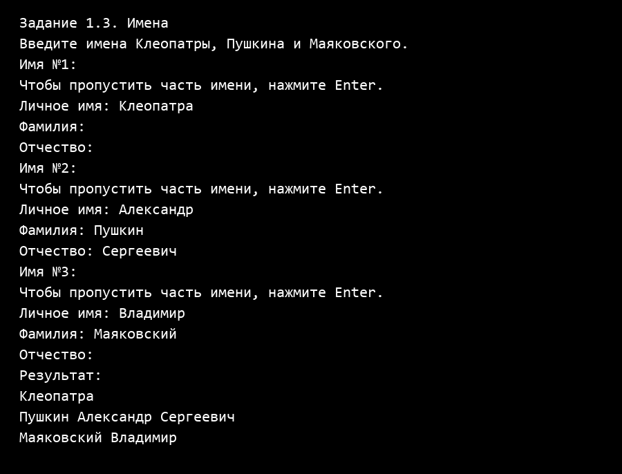

Проверка отсутствующих частей: полностью пустое имя, только фамилия и только отчество:

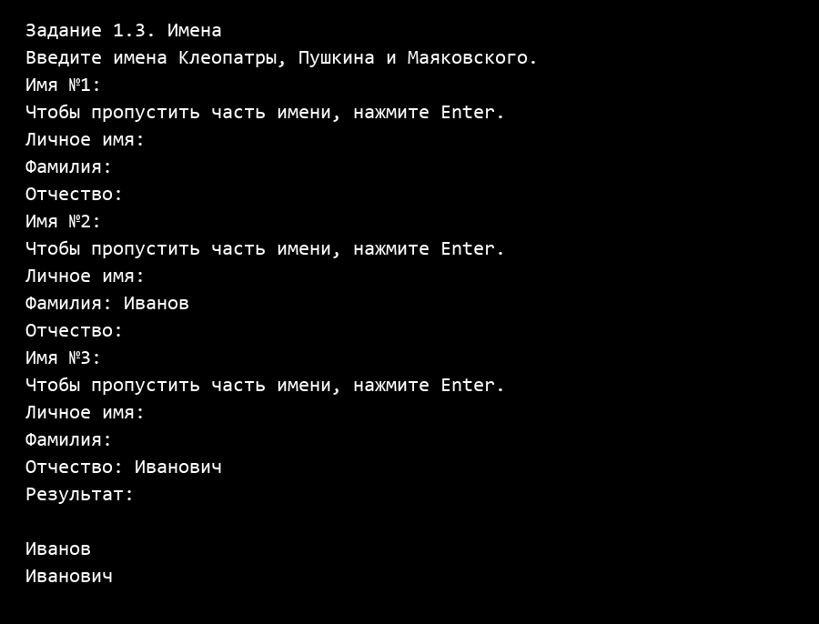

# Задание 2

## Задача 2

### Текст задачи

Человек с именем.

Объедините сущности Человек из задачи 1.2 и Имя из задачи 1.3 таким образом, чтобы имя человека задавалось с использованием сущности 1.3, а не строки.

Необходимо объединить ранее созданные объекты имён и людей, с получением:

- Человека с Именем Клеопатра и ростом 152;
- Человека с Именем Пушкин Александр Сергеевич и ростом 167;
- Человека с Именем Маяковский Владимир и ростом 189.

### Алгоритм решения

1. Создать класс `Person`, который хранит объект `PersonName` и рост в сантиметрах. Для полей определить обычные свойства.
2. Ввести с клавиатуры части имени и положительный целочисленный рост каждого из трёх людей.
3. Передать созданный объект имени и рост в конструктор `Person`.
4. Вывести людей через `ToString()`. Один общий класс используется также в задачах 2.3 и 4.6, поэтому итоговый формат соответствует задаче 4.6: «Имя, рост».
5. Класс хранить в отдельном файле `Person.cs`. Первую версию `Person` полностью закомментировать под номером 2.2. Проверку ссылки на имя и положительного роста оставить внутри класса `Person`; ввод роста и проверку целого положительного числа выполняет его метод `ReadHeight()`.

### Тестирование

Создание трёх людей с именами и ростом из условия:

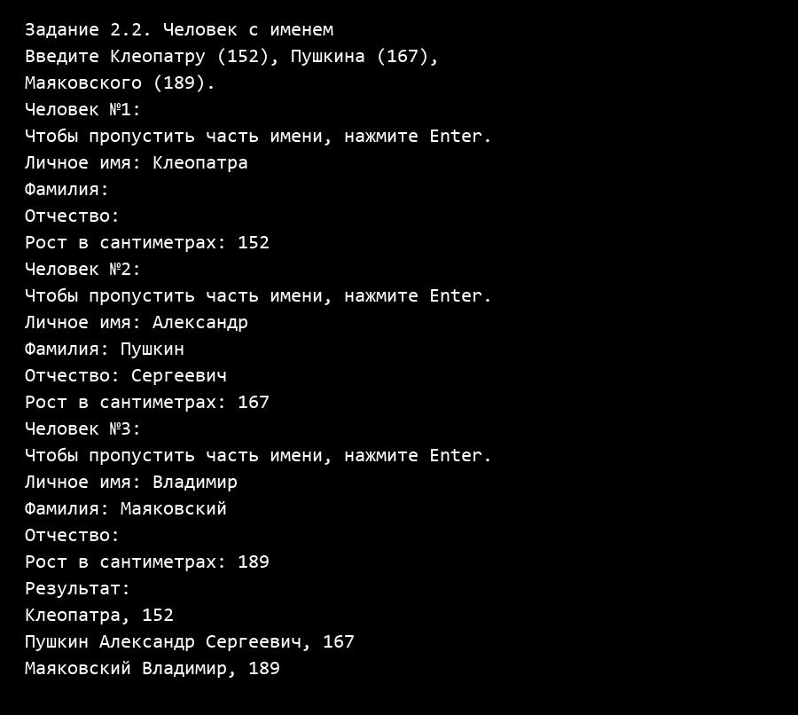

Проверка текста вместо роста, нулевого роста и числа за пределами типа `int`:

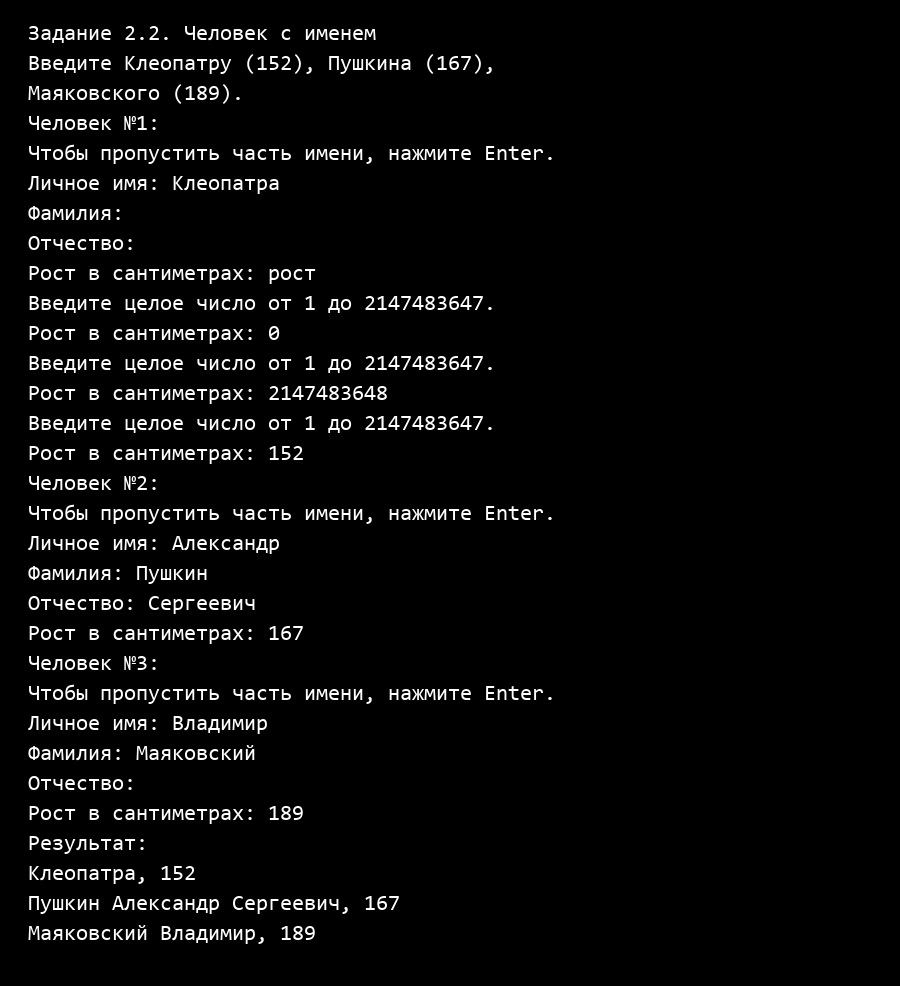

## Задача 3

### Текст задачи

Человек с родителем.

Измените сущность Человек из задачи 2.2, добавив ему возможность задавать третий параметр: Отец, где Отец — это тоже Человек. При приведении человека к строковой форме необходимо проверить параметры имени и в зависимости от ситуации выполнить одно из следующих действий:

- Если у данного человека нет фамилии и есть отец, у которого фамилия задана, то фамилию необходимо сделать такой же, как у отца.
- Если у данного человека нет отчества, а у отца есть имя, то необходимо задать отчество как имя отца с добавлением суффикса «ович».

Затем необходимо выполнить следующие задачи:

1. Создать людей: Чудова Ивана, Чудова Петра, Бориса.
2. Сделать Ивана отцом Петра, а Петра отцом Бориса.
3. Вывести на экран строковое представление всех троих людей.

При желании можно попытаться реализовать систему в более полном виде: предусмотреть разные виды суффиксов отчества в зависимости от окончания имени, а также предусмотреть возможность задавать пол человека и менять суффикс отчества в зависимости от пола.

### Алгоритм решения

1. Добавить в `Person` поле отца типа `Person` и свойство для его чтения. Передавать отца при создании человека.
2. В методе `CompleteName()` проверить наличие отца. Если его нет, завершить метод.
3. Сначала дополнить имя отца, чтобы фамилия могла передаваться через несколько поколений.
4. Если фамилия человека отсутствует, взять фамилию отца. Если отсутствует отчество и личное имя отца известно, составить отчество по правилу «личное имя отца + ович». Уже заданные фамилию и отчество сохранять.
5. Вызывать дополнение имени в основном конструкторе и перед строковым представлением.
6. Ввести данные трёх людей. Первого передать как отца второму, а второго — третьему. Вывести результат. Рост также вводится с клавиатуры, поскольку остаётся обязательным свойством человека.
7. Полную промежуточную версию `Person` сохранить в комментарии под номером 2.3. Метод дополнения имени находится внутри самого класса.

### Тестирование

У Петра появляется отчество Иванович, у Бориса — фамилия Чудов и отчество Петрович:

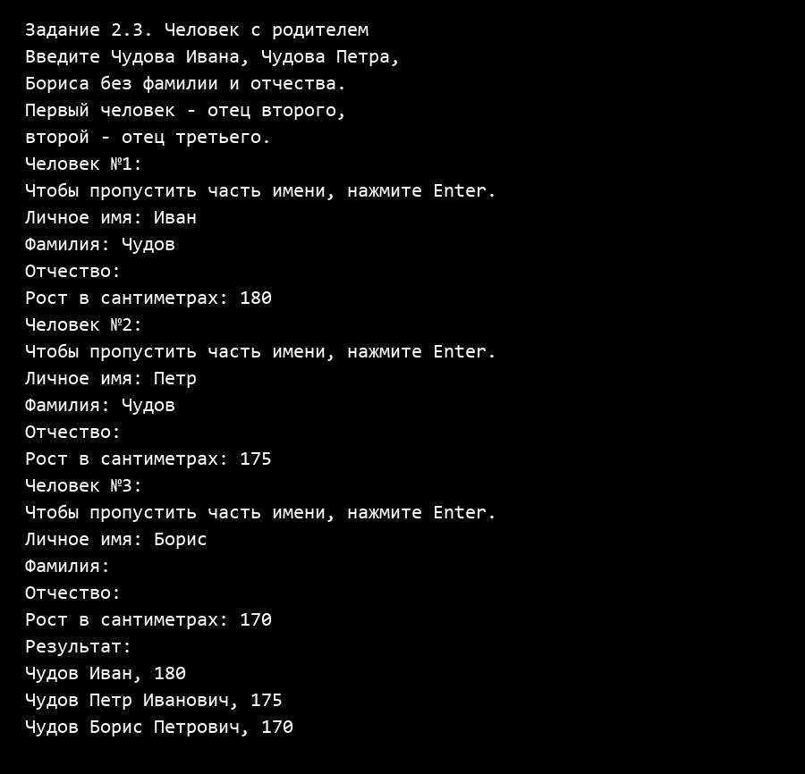

Проверка сохранения явно заданных фамилии «Другой» и отчества «Особое». Борис получает фамилию своего отца:

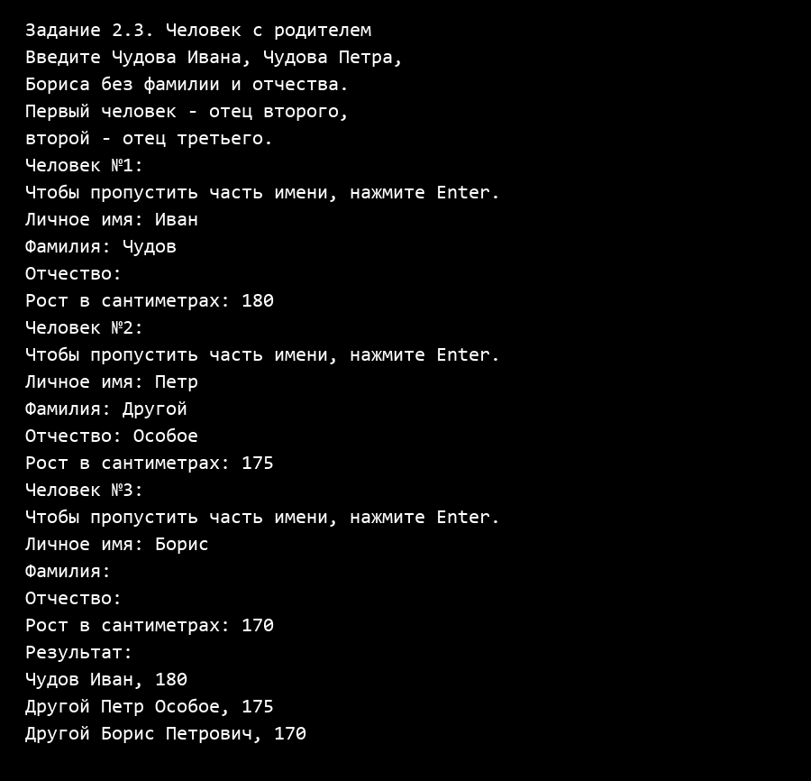

# Задание 3

## Задача 3

### Текст задачи

Города.

Создайте сущность Город, которая будет представлять собой точку на карте со следующими характеристиками:

- Название города.
- Набор путей к следующим городам, где путь представляет собой сочетание Города и стоимости поездки в него.

Кроме того, Город может возвращать текстовое представление в виде названия города и списка связанных с ним городов в виде пары «название:стоимость».

Используя разработанную сущность, реализуйте схему, представленную на рисунке 2.

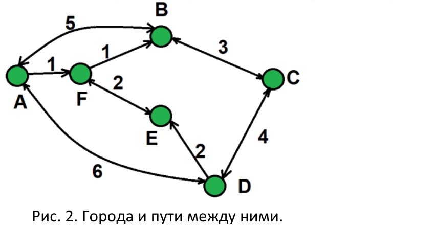

### Алгоритм решения

1. Создать класс `City` в файле `City.cs`. Хранить название города и словарь `Dictionary<City, int>`, где ключ — город назначения, а значение — стоимость поездки.
2. Методом `AddRoute()` добавлять исходящий путь. Проверить, что город назначения указан, а стоимость неотрицательная. При повторном указании того же города обновить стоимость пути.
3. Ввести названия шести городов. Пустое название не принимать. Проверку названия выполнять в свойстве класса `City`. Ограничения на символы и совпадение названий не вводить.
4. Ввести восемь стоимостей с рисунка. Создать двусторонние дороги A ↔ B со стоимостью 5, B ↔ C — 3, C ↔ D — 4, E ↔ F — 2, A ↔ D — 6. Для каждой добавить два исходящих пути.
5. Создать односторонние дороги A → F со стоимостью 1, F → B — 1, D → E — 2. Для каждой добавить один исходящий путь. Всего получается 13 направленных путей.
6. В `City.ToString()` перебрать исходящие пути и вывести их вместе с названием города. Выводить только название соседнего города, чтобы не возникало бесконечного обхода двусторонних дорог.
7. Название вводить методом `City.ReadName()`, дорогу и обратный путь добавлять методом `City.ReadRoute()`. Числовой ввод стоимости проверять внутренним методом `City.ReadCost()`. Все данные и проверки путей находятся внутри `City`.

### Тестирование

Схема из условия: проверены все шесть списков исходящих путей и их стоимости:

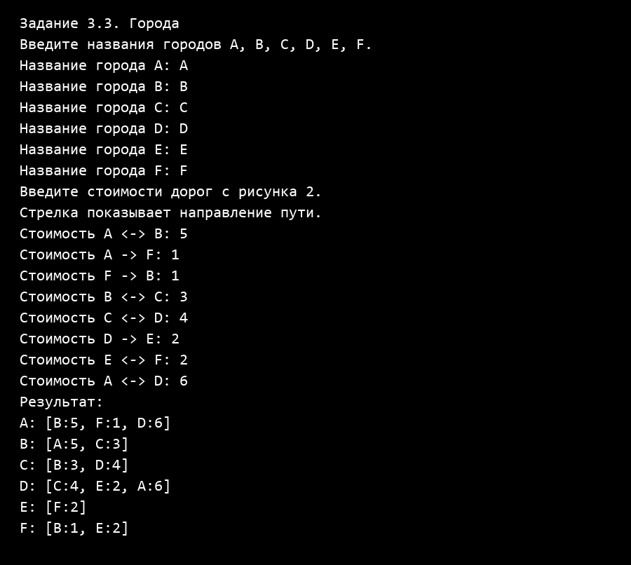

Проверка пустого названия, отрицательной и нечисловой стоимости:

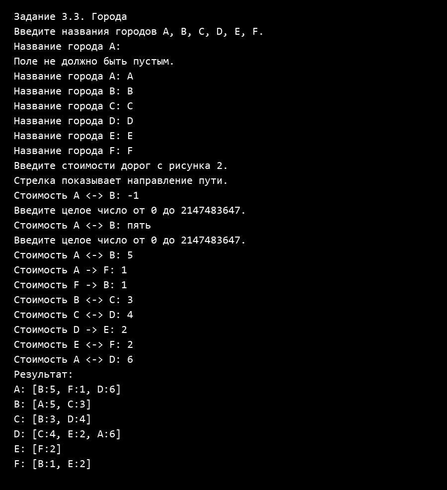

# Задание 4

## Задача 5

### Текст задачи

Создаём Имена.

Измените сущность Имя из задачи 1.3. Новые требования включают:

- Имя можно создать, указав только Личное имя.
- Имя можно создать, указав Личное имя и Фамилию.
- Имя можно создать, указав все три параметра: Личное имя, Фамилию, Отчество.

Необходимо создать следующие имена:

1. Клеопатра.
2. Александр Сергеевич Пушкин.
3. Владимир Маяковский.
4. Христофор Бонифатьевич (здесь Христофор — это имя, а Бонифатьевич — фамилия).

### Алгоритм решения

1. Дополнить общий класс `PersonName` конструкторами с одним и двумя строковыми параметрами. Конструктор с тремя параметрами используется как основной.
2. Из конструкторов с меньшим числом параметров вызвать основной через `this`, передав пустые строки для отсутствующих частей имени.
3. Ввести с клавиатуры данные четырёх имён. Создать Клеопатру конструктором с одним параметром, Александра — с тремя, Владимира и Христофора — с двумя.
4. Вывести имена. Порядок вывода остаётся таким, как в задаче 1.3: «Фамилия Имя Отчество». Поэтому последняя строка имеет вид «Бонифатьевич Христофор».

### Тестирование

Использование всех трёх конструкторов. Бонифатьевич хранится именно как фамилия:

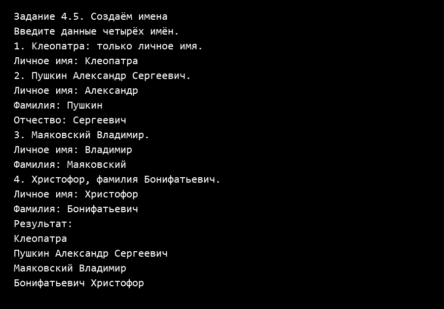

Проверка пустого обязательного личного имени:

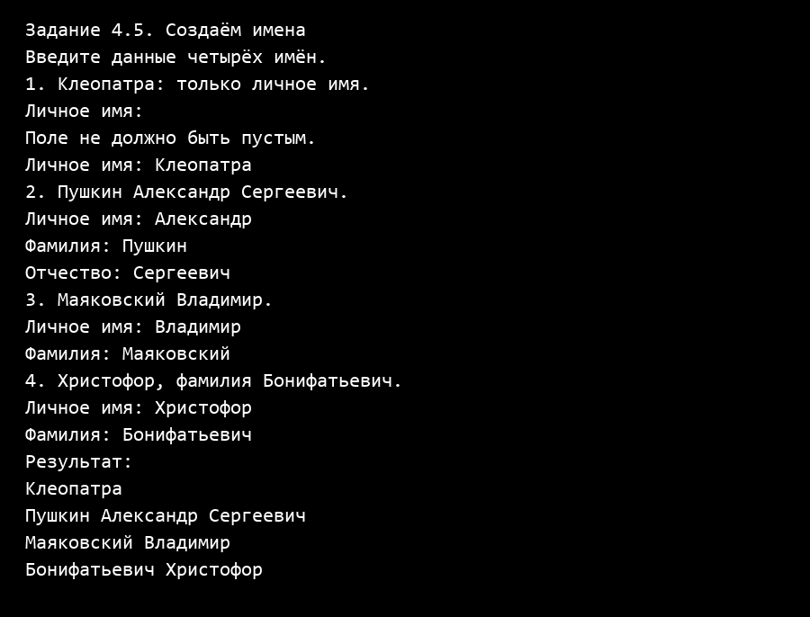

## Задача 6

### Текст задачи

Создаём Человека.

Измените сущность Человек из задачи 2.3. Новые требования включают:

- Человека можно создать с указанием имени в виде строки и роста в виде целого числа. При таком способе задания имени должно считаться, что Человеку задано только личное имя.
- Человека можно создать с указанием имени в виде строки, роста в виде целого числа и отца в виде Человека. В этом случае необходимо проставить отчество в соответствии с именем отца и присвоить текущему человеку фамилию отца.
- Человека можно создать с указанием имени в виде объекта типа Имя из задачи 4.5 и роста в виде целого числа.
- Человека можно создать с указанием имени в виде объекта типа Имя из задачи 4.5, роста в виде целого числа и отца в виде Человека. В этом случае необходимо проверить, что в Имени заданы отчество и фамилия, и если они не заданы, то необходимо их задать: отчество в соответствии с именем отца и фамилию отца.
- Реализуйте описанные способы создания Человека таким образом, чтобы операции присвоения использовались только в одном из конструкторов.
- Необходимо модифицировать способ приведения Человека к строке: теперь текстовая форма должна быть представлена строкой «Имя, рост».

Создайте и выведите на экран следующие объекты:

1. Человека с именем Лев в виде строки и ростом 170.
2. Человека с именем Пушкин Сергей как Имя, ростом 168 и отцом Львом — предыдущим Человеком.
3. Человека с именем Александр в виде строки, ростом 167 и отцом Сергеем — предыдущим Человеком.

### Алгоритм решения

1. Реализовать четыре конструктора `Person`: строка и рост; строка, рост и отец; объект имени и рост; объект имени, рост и отец.
2. Во всех конструкторах, кроме основного, использовать вызов `this`. Строку преобразовывать в объект `PersonName`, содержащий только личное имя.
3. Присваивать имя, рост и отца только в основном конструкторе с параметрами `PersonName`, `int`, `Person`. В нём вызвать `CompleteName()`.
4. Ввести данные Льва, Сергея и Александра. Создать Сергея с отцом Львом, а Александра — с отцом Сергеем. Существующие фамилию и отчество сохранять, отсутствующие дополнять.
5. Вывести людей в формате «Имя, рост». Правило отчества из задачи 2.3 применяется буквально: «Левович» и «Сергейович».
6. Дополнительно показать четвёртый способ создания: передать объект имени Александра и его рост без отца.
7. Каждый класс хранить в своём файле. Проверки частей имени находятся в `PersonName`, роста — в `Person`, названия города и стоимости пути — в `City`, имени кота и количества повторений — в `Cat`. В `Program.cs` находятся главное меню, проверка его выбора и выполнение заданий. Под номером 4.6 в `Person.cs` находится рабочий класс; его версии из 2.2 и 2.3 полностью сохранены в комментариях.

### Тестирование

Создание людей из условия и демонстрация всех четырёх конструкторов:

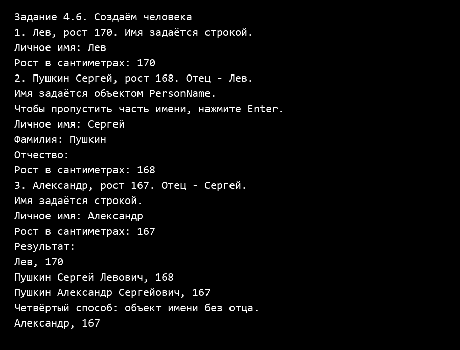

Проверка отрицательного роста и успешного повторного ввода:

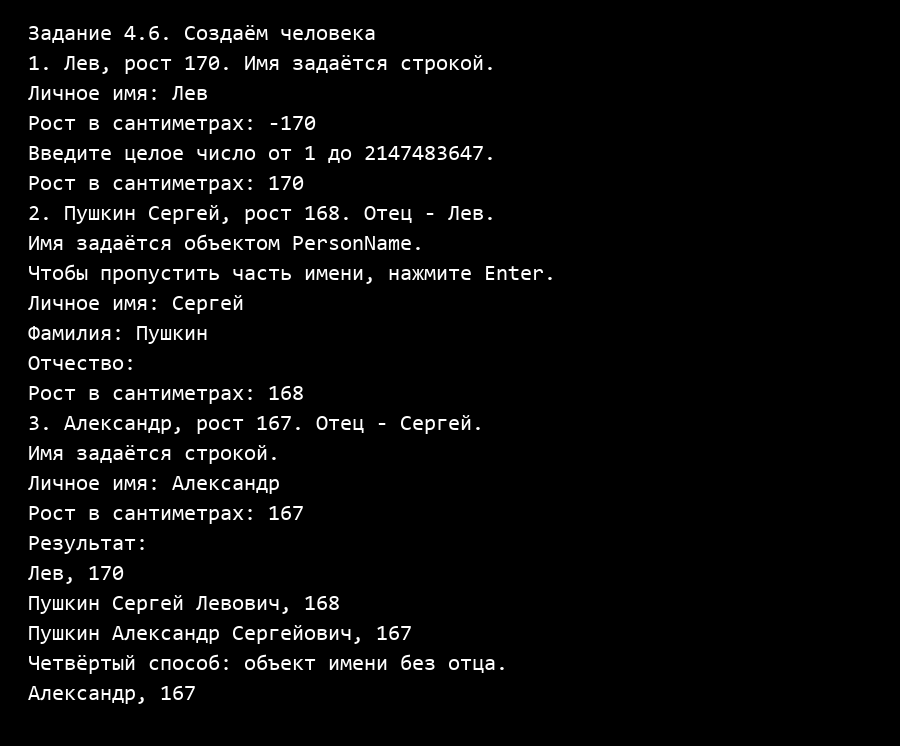

# Задание 5

## Задача 2

### Текст задачи

Кот мяукает.

Создайте сущность Кот, которая описывается следующим образом:

- Имеет Имя — строку.
- Для создания необходимо указать имя кота.
- Может быть приведён к текстовой форме вида «кот: Имя».
- Может помяукать, что приводит к выводу на экран следующего текста: «Имя: мяу!», вызвать мяуканье можно без параметров.
- Может помяукать N раз, что приводит к выводу на экран следующего текста: «Имя: мяу-мяу-…-мяу!», где количество «мяу» равно N.

Создайте кота по имени «Барсик», и затем пусть он помяукает сначала один раз, а затем три раза.

### Алгоритм решения

1. Создать класс `Cat` с закрытым полем имени, обычным свойством `Name` и конструктором, принимающим имя.
2. В `ToString()` возвращать строку «кот: Имя».
3. Метод `Meow()` без параметров вызывает `Meow(1)`.
4. В `Meow(int count)` проверить, что количество положительное. Вывести имя, затем циклом необходимое число слов «мяу», разделяя их дефисами, и завершить строку восклицательным знаком.
5. Ввести имя кота и положительное целое количество повторений с клавиатуры. Создать кота, вывести его и вызвать оба метода. Ограничение в 1000 повторений не использовать.
6. Класс хранить в отдельном файле `Cat.cs`. Проверки непустого имени и положительного количества повторений выполнять внутри `Cat`: ввод имени — в `ReadName()`, ввод количества — в `ReadCount()`. Повторно запрашивать количество, если введён текст, дробное число, неположительное число или число за пределами `int`.

### Тестирование

Барсик мяукает сначала один раз, затем три раза:

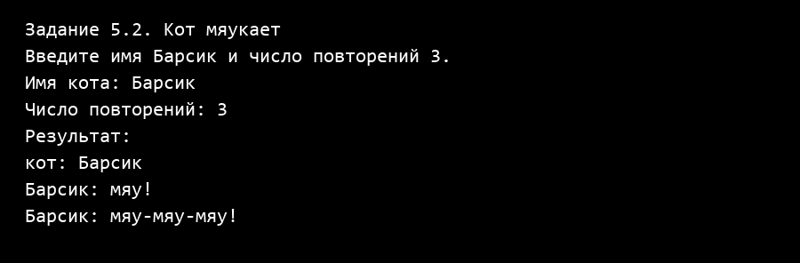

Проверка пустого имени, нулевого, отрицательного, дробного количества повторений и числа за пределами типа `int`:

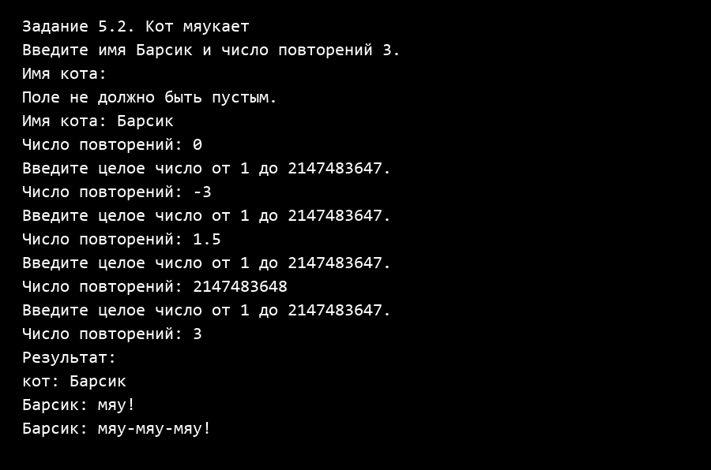

Проверка неверного выбора в главном меню и выхода из программы:

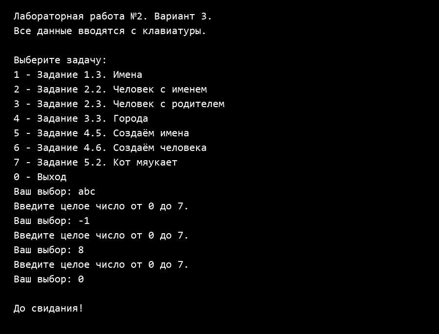
